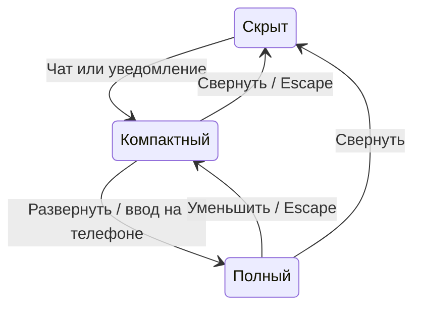

# D-021 — чат0/¼/full и уведомления

14.10.2026: владелец поручил перенести поведение чата прежней Дезертовии0.4
в новую инженерную основу, сохранив оформление и функциональность. «Приступай»
разрешает реализацию. Источник поведения: legacy assets/town/features.js,
chatMode/chatToast (4200ms, открытие quarter, счётчик, Escape), shell.js.

## Структура

Телефон: крупная кнопка над нижними действиями. До2 коротких уведомлений
над кнопкой, не поверх самих действий. Quarter: примерно четверть высоты с
минимумом для шапки/списка/ввода, карта доступна выше. Full: игровая область,
шапка Чат/События/¼/Свернуть, история и ввод. VisualViewport учитывает клавиатуру
и безопасные отступы. ПК: компактная панель в нижнем левом углу, full — область
игры. Timber/gold оформление сохранено; тёмное оформление по предпочтению устройства.

Текущий авторский чат имеет общий разговор и переключение событий. Отдельных
существующих private/local каналов в этой реализации не найдено; не создавать
фиктивные вкладки. История, отправка, события, членство, NPC/Tsar/citizen identity,
SignalR и речевые облака на карте сохраняются.

## Поведение

- Три состояния сохраняются в localStorage; миграция старого collapsed.
- Draft и scroll сохраняются при смене режима, ChatPanel не размонтируется.
- Пока читают старое: не прокручивать вниз, показать Новые сообщения и счётчик.
- Уведомления только для новых чужих live arrivals, включая батюшку. История,
  reconnect backfill, собственные сообщения и повторы не создают popups.
- Отдельный bounded arrival buffer в useLiveVillage; существующая дедупликация
  принимает history IDs, предотвращая повторное объявление истории после reconnect.
- Toast4.2s, максимум2, длинный текст2 строки; счётчик учитывает все новые линии.
- Full: доступная область VisualViewport, Escape/Tab, underlying HUD inert,
  FPS карты снижён через существующий obscured; игровые часы не изменяются.
- Другие игровые модальные окна уменьшают full чат, сохраняя draft/scroll.
- Права и серверные лимиты не меняются, базы/прогресс/свечи не сбрасывать.

## Проверка перед выпуском

Телефон320/390, ПК16:9; три режима, размер/границы кнопок, draft/scroll,
приход истории без popup, live popup/expiry/burst, own/NPC, scrollback,
обновление/reconnect, клавиатура и переключение Событий/отправка/ошибки.
Полный CI; обычный backup/deploy; проверенные SHA и результаты записать здесь.
Статус: реализация в отдельной ветке, ещё не выпущена.

Уточнение владельца: добавить количество игроков онлайн. Во всех режимах
показывать активных жителей и присутствующих из citizens/away; NPC и работающие
офлайн не увеличивают онлайн. Existing CitizenPresence использует подключение
или5мин недавней активности. Царь/зрители без citizen в текущую модель
CitizenPresence не входят, поэтому подпись честная: «жителей», не все аккаунты
или подключения. Новую модель presence/серверные правила в этом этапе не менять.

Владелец зафиксировал номер этого выпуска0.5. SettingsPanel показывает brand
и номер из web/package.json (0.5.0 в semver,0.5 на экране). Следующий номер
менять в package.json/lock вместе с release record; не держать отдельные
несогласованные константы в UI.
